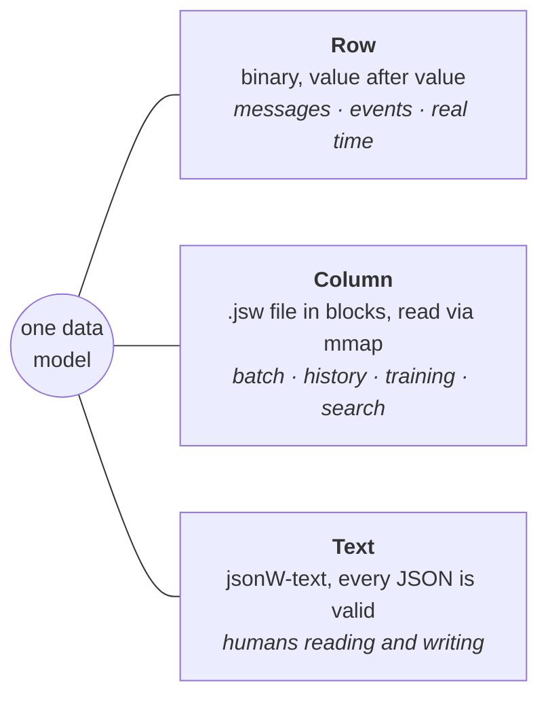
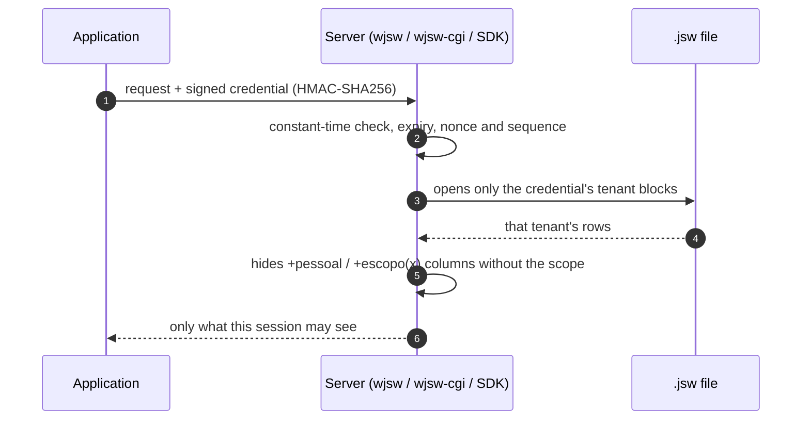

<p align="center">
  <picture>
    <source media="(prefers-color-scheme: dark)" srcset="assets/banner-escuro-en.svg">
    
  </picture>
</p>

<p align="center">
  <a href="https://www.npmjs.com/package/@wortictecnologia/jsonw"></a>
  <a href="https://jsonw.org"></a>
  
  
  
  
  
</p>

<p align="center">
  <a href="https://jsonw.org"><b>Site</b></a> ·
  <a href="https://jsonw.org/paper/en"><b>Paper</b></a> ·
  <a href="docs/JSONW.md"><b>Docs (pt-BR)</b></a> ·
  <a href="#30-second-start"><b>Start</b></a> ·
  <a href="AGENTS.md"><b>For AI agents</b></a> ·
  <a href="llms.txt"><b>llms.txt</b></a> ·
  <a href="README.md"><b>Português</b></a>
</p>

---

Today the same record travels as **JSON**, is stored as **CSV or Parquet**, is copied into a **vector database** for semantic
search and goes through yet another **permission layer**. Every conversion costs time and memory, and sometimes the data
itself: the price that became a string, the ID that lost its leading zero, the weight nobody knows was grams or kilos.

**jsonW** (json Wondrous) is one data model with **three lossless forms**, with business types, search, ranking, permissions
and custody **inside the format**. Zero-dependency C core, maintained by [Wortic](https://wortic.com.br), which runs its own
agent index, AI models and network edge on it.

```text
6.6×     smaller than uncompressed JSONL
2,508×   faster to read a whole column
0        dependencies: C and the standard library
```
<sub>Measured 2026-11-12 with 1.2.1: 100k synthetic records, median of 10 runs, against the same set in JSONL read by our own JSON
reader. JSONL compressed with zstd or xz is smaller on that data, and faster JSON libraries narrow the gap; the single-column
gap comes from the columnar layout. Methodology and limitations in the <a href="https://jsonw.org/paper/en">paper</a>.
Measure on your machine: <code>wjsw medir</code>.</sub>

## 30-second start

```bash
git clone https://github.com/developer-wortic/jsonw && cd jsonw
P=bin/macos-arm64            # or bin/linux-x86_64, bin/windows-x86_64 (wjsw.exe)

printf '%s\n' '{"id":1,"product":"Coffee","price":"12.50 USD","weight":"250 g","sku":"CAF-0250"}' \
              '{"id":2,"product":"Cheese bread","price":"8.90 USD","weight":"1 kg","sku":"PDQ-1000"}' > sales.jsonl

$P/wjsw de-texto "id:i64,product:texto,price:dinheiro,weight:medida[g],sku:codigo" sales.jsonl sales.jsw
$P/wjsw ver sales.jsw          # rows in jsonW-text: weight 1 kg became 1000 g (column is medida[g])
$P/wjsw conferir sales.jsw     # full custody check (sha256 + crc32c)
$P/wjsw para-texto sales.jsw --json   # back to JSON, lossless
```

> The schema and the CLI speak Portuguese (`texto` = text, `dinheiro` = money, `medida` = measure, `codigo` = exact code,
> `ver` = view, `conferir` = verify, `filtrar` = filter). The full type and command reference is in [`AGENTS.md`](AGENTS.md).

## Three forms, one model



| Form | Replaces | For |
|---|---|---|
| **Row** | JSON, MessagePack, CBOR, Protobuf | messages, events, real time |
| **Column** (`.jsw`) | JSONL, CSV, Parquet | files, batches, training, search; zero-copy `mmap` |
| **Text** (jsonW-text) | JSON, TOML, YAML | humans; **every valid JSON is valid jsonW-text** |

## Types JSON doesn't have

Exact decimal (`decimal[2]`, never floating point) · money with ISO 4217 currency per value (`dinheiro`) · measures with 89
units, converted on write (`medida[kg]`) · exact codes stored byte for byte (`codigo`) · full Unicode text · microsecond UTC
time · validated URLs · dictionary-encoded text (`dic`) · vectors (`vf32`, `vf16`, `bits`, `vq8`, `vq4`) · tensors
(`tensor<bf16>[768,768]`) · media · lists, objects, maps and open JSON (`qualquer`). Readers accept both `1,234.56` and
`1.234,56`, independent of process locale.

## The 14 features

| # | Feature | In one line |
|---|---|---|
| 1 | **Term search** | sparse vector with IDF |
| 2 | **Semantic search** | cosine over dense `vf32`, `vf16`, `vq8` or `vq4` vectors |
| 3 | **Multilinear grid** | bilinear, trilinear and beyond, straight from the file |
| 4 | **Scoring request** | weights, cosine, sparse or grid in a one-line request |
| 5 | **Top-k** | heap-based, deterministic (higher score first, ties by lower row) |
| 6 | **Zones** | min and max per block and column: searches skip whole blocks |
| 7 | **Dictionary** | repeated text stored once per file |
| 8 | **Key index** | straight to a key's row, no scan |
| 9 | **Lexicon** | Aho-Corasick automaton read from disk; whole words, accent- and case-insensitive |
| 10 | **Live writing** | read while another process writes, never seeing half a block |
| 11 | **Live, deleted and history** | rewrite a key to edit; `_apagado: true` deletes; compaction keeps only what's live |
| 12 | **Permission views** | column, row and cell, per credential |
| 13 | **Custody** | chained crc32c + SHA-256 (or BLAKE3): any changed byte fails `conferir` |
| 14 | **Partial remote read** | via HTTP Range, fetch only the blocks of the rows you read |

## Permissions inside the format



- **Credential:** issuer, subject, tenant, scopes and expiry, HMAC-SHA256 verified in constant time, nonce + sequence against
  replay, on top of TLS.
- **Column:** `+escopo(x)` shows only with scope `x`; `+pessoal` (personal data) only with scope `pessoal`. Hidden columns
  can't be used in filters either.
- **Row:** with an integer (`i64`) `tenant` or `tenant_id` column, only the credential's tenant rows are visible; other tenants' blocks are never opened. A text `tenant` column closes the view (nothing leaves).
- **Cell:** both together. Hidden data never leaves the server.

## SDKs

A stable C ABI ([`sdk/jsonw.h`](sdk/jsonw.h) + `libjsonw`) and one SDK per language, all checked by the same byte-for-byte
test (`cd sdk && bash prova.sh`): **C, C++17, Python 3, Node.js, PHP 8, Go, Rust, Java 22+, Kotlin, Swift**. Node.js from npm:
`npm install @wortictecnologia/jsonw` (prebuilt for macOS arm64 and Linux x64, plus the `jsonw` command).

```python
import jsonw
with jsonw.Escritor("sales.jsw", "id:i64,product:texto,price:dinheiro") as w:   # Escritor = writer
    w.gravar({"id": 1, "product": "Coffee", "price": "12.50 USD"})            # gravar = write
with jsonw.Leitor("sales.jsw") as r:                                          # Leitor = reader
    print(r.campo(0, "price"))                                                # campo = direct field access
    r.conferir()                                                              # conferir = verify custody
```

## Databases you already use

jsonW doesn't ask you to switch databases. `wcon` moves data from your database into a `.jsw` and back, **round trip with no
loss**, and `wremoto` reads a `.jsw` stored on R2, S3 or any HTTP server, downloading only the blocks a query needs.

| Database | Database → jsonW | jsonW → database | How the write-back is applied |
|---|---|---|---|
| **PostgreSQL** | `wcon pg "<sql>" out.jsw` | `wcon pg-gravar file.jsw schema.table` | one transaction: staging table, binary COPY, typed `INSERT … SELECT` |
| **MySQL · MariaDB** | `wcon mysql host:port/db "<sql>" out.jsw` | `wcon mysql-gravar file.jsw host:port/db table` | one transaction, binary prepared statements; any error rolls back |
| **SQLite** | `wcon sqlite file.db "<sql>" out.jsw` | `wcon sqlite-gravar file.jsw file.db table` | one transaction; creates the table if missing |
| **Redis · Valkey** | `wcon redis host:port "pattern*" out.jsw` | `wcon redis-gravar file.jsw host:port` | `MULTI/EXEC`: string, hash, list, set, zset and each key's TTL |
| **MongoDB** | `wcon mongo host:port/db collection '{"filter":1}' out.jsw` | `wcon mongo-gravar file.jsw host:port/db collection` | ordered batch inserts |
| **JSON · JSONL** | `wjsw de-json in.jsonl out.jsw` (schema inferred) | `wjsw para-texto file.jsw --json` | — |
| **R2 · S3 · HTTP** | `wremoto info\|ver\|filtrar <url>` | — | read-only, by Range |

**The schema comes from the database itself:** `numeric` → exact `decimal`; `bigint` → exact `i64`; Postgres `timestamptz`, `timestamp`
and `date` → `tempo` (µs UTC, written back exactly); MySQL and SQLite `DATE`/`DATETIME` stay text on purpose (with no zone in
the database, midnight UTC would shift the day); `uuid`, `bytea`, `bool`,
arrays → `uuid`, byte-exact `codigo`, `bool`, `lista<t>`; `jsonb` → `qualquer`; pgvector `vector`/`halfvec` → `vf32[n]`/`vf16[n]`;
MongoDB `ObjectId`/`Decimal128` in Extended JSON; SQLite by the storage class of each value.

**Safe by construction:** values always travel as data with a length prefix (binary COPY, bound parameters, RESP, prepared
statements, BSON), never spliced into a command. Passwords come from a file (`WMYSQL_CRED`, `WMONGO_CRED`, `WREDIS_CRED`,
`WJSW_R2_CRED`; Postgres uses `WSQL_URL` plus `PGPASSWORD` or `~/.pgpass`), never from the command line or the output.

**Tested against the real thing**, cell by cell and under hostile input (SQL/JSON/RESP injection, quotes, `\0`, emoji, RTL):
PostgreSQL 14, 16 and 18 (md5 on both sides), SQLite (`quote()`/`typeof()`), MariaDB 11.8 (`hex()` on 12 columns), Redis 7 (all
5 types + TTL), MongoDB 7 (canonical Extended JSON), a 435 MB JSONL (md5 via `jq -S`).

<sub>Today MySQL 8 connects with `mysql_native_password` (full `caching_sha2_password` authentication isn't there yet; MariaDB
works fully). `wcon` and `wremoto` ship for macOS and Linux; on Windows, run them under WSL. Each is a standalone program
(no `wjsw` or `libjsonw` needed next to it) and uses one system library: `wcon` needs `libsqlite3` and `wremoto` needs `libcurl`
(already on macOS; on Debian/Ubuntu: `apt install libsqlite3-0 libcurl4`). `wjsw`, `wjsw-cgi` and `libjsonw` depend on nothing
but the standard library.</sub>

### On Cloudflare R2 (or any S3), without downloading the whole file

Keep the `.jsw` in a bucket and query it in place. `wremoto` fetches the header and footer, then only the blocks a query
needs; the footer zones rule out blocks that cannot hold the answer, and those are never downloaded. R2 charges no egress, so
reading a slice of a 10 GB file costs what the slice costs.

```bash
export WJSW_R2_CRED=~/.cred/r2                         # file with key:secret (never on the command line)
wremoto info    r2://my-bucket/sales.jsw               # rows, blocks and how much it downloaded to open
wremoto ver     r2://my-bucket/sales.jsw 1000000 5     # 5 rows starting at row 1,000,000
wremoto filtrar r2://my-bucket/sales.jsw "preco > 100"
wremoto info    https://data.example.com/sales.jsw     # any HTTP server with Range (public R2 too)
```

Every request to R2 or S3 is signed with AWS SigV4; the same file can be served by R2 itself, a Worker or any CDN.

## Web servers

`wjsw-cgi` runs on **Apache, nginx (fcgiwrap), LiteSpeed, Caddy and IIS**, and **every `.jsw` request goes through it**,
because only it knows what the session may see: a file with no marked column and no tenant is delivered as is, with Range
(206) and CORS; everything else is filtered by the mandatory permission view (`?formato=json|ndjson`, `?onde=`, `?campos=`,
`?limite=`). Ready-made configs in [`servidores-web/`](servidores-web/).

> **If you installed the 1.2.0 (or earlier) config, replace it.** There the web server delivered the `.jsw` by itself when a
> request had no parameter, so the raw file went out with the `+pessoal`/`+escopo(x)` columns and every tenant's rows. Since
> 1.2.1 no `.jsw` is served without going through `wjsw-cgi`.

## Platforms

macOS arm64 · Linux x86_64 · Windows x86_64 (`wjsw`, `wjsw-cgi`, `libjsonw` static and shared, Node addon on macOS and Linux).
Database connectors `wcon` and `wremoto`: macOS arm64 and Linux x86_64. Linux binaries need glibc 2.34+ (Ubuntu 22.04+,
Debian 12+, RHEL 9+).

## Post-quantum ready

jsonW's wire protocol runs over QUIC with TLS 1.3 and the **X25519MLKEM768** post-quantum key exchange (NIST ML-KEM,
FIPS 203). Custody and credentials use only 256-bit hashes and HMAC, which remain secure against quantum computers.

## License and transparency

**[Sustainable Use License](LICENCA.md)** (Portuguese): free to use inside your products, on as many servers as you like; you
may not resell jsonW itself as a service or reverse-engineer the core. On first run per machine, `wjsw` sends only its
version and platform and writes `~/.jsonw/instalou`; no names, paths, data or IPs are kept. Opt out with `JSONW_SEM_PING=1`.
**The library and SDKs never touch the network.**

---

<p align="center">
  <a href="https://wortic.com.br"></a><br/>
  <sub>jsonW is created and maintained by <a href="https://wortic.com.br">Wortic</a>.</sub>
</p>
