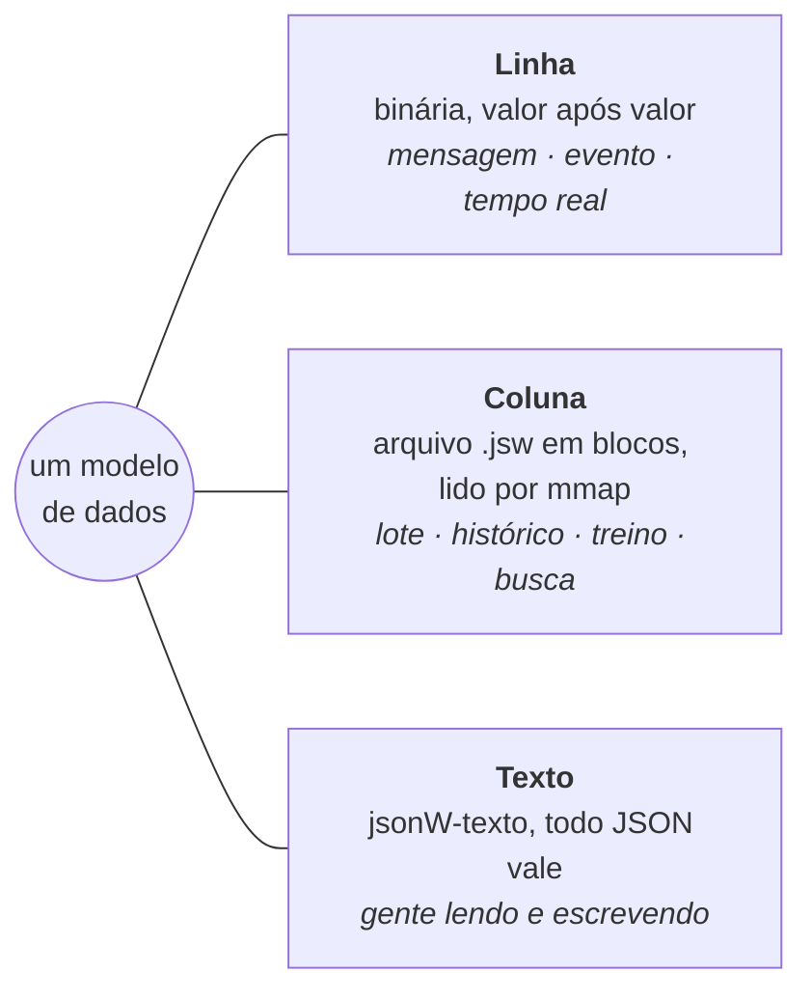
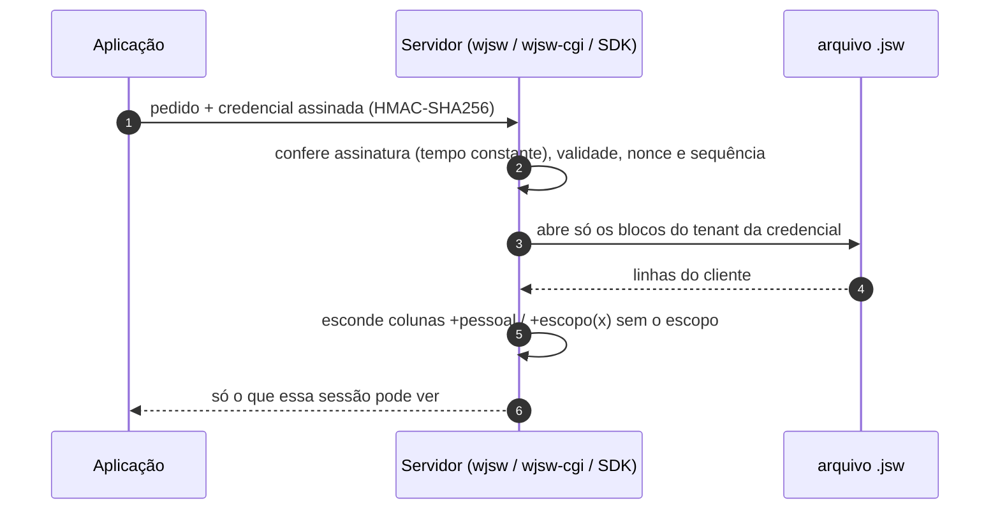
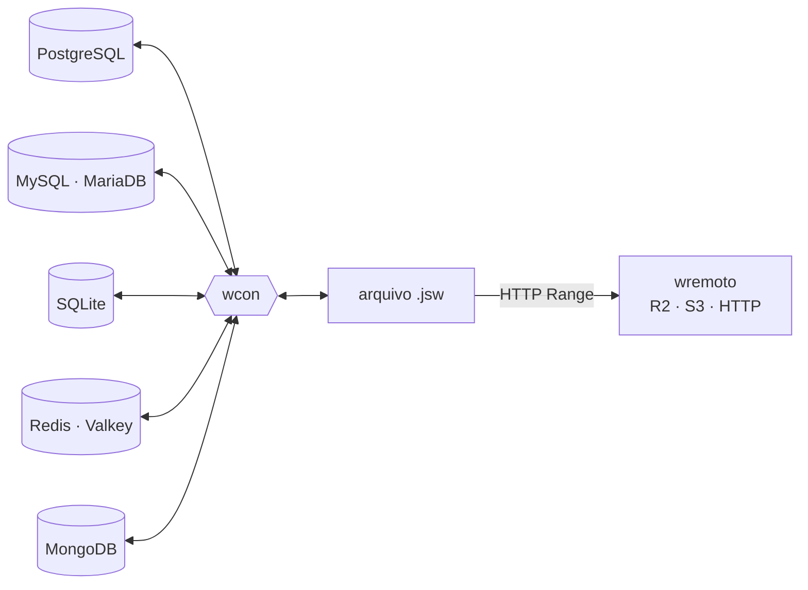
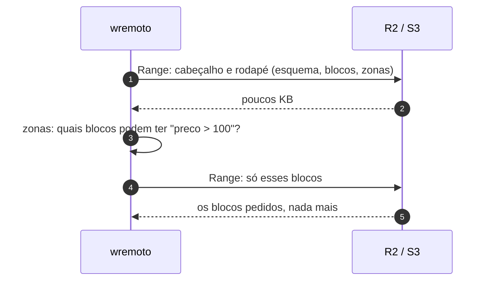

<p align="center">
  <picture>
    <source media="(prefers-color-scheme: dark)" srcset="assets/banner-escuro-pt.svg">
    
  </picture>
</p>

<p align="center">
  <a href="https://www.npmjs.com/package/@wortictecnologia/jsonw"></a>
  <a href="https://jsonw.org"></a>
  
  
  
  
  
</p>

<p align="center">
  <a href="https://jsonw.org"><b>Site</b></a> ·
  <a href="https://jsonw.org/paper"><b>Paper</b></a> ·
  <a href="docs/JSONW.md"><b>Documentação</b></a> ·
  <a href="#em-30-segundos"><b>Começar</b></a> ·
  <a href="AGENTS.md"><b>Para IAs (AGENTS.md)</b></a> ·
  <a href="llms.txt"><b>llms.txt</b></a> ·
  <a href="README.en.md"><b>English</b></a>
</p>

---

Hoje o mesmo dado passa por **JSON** para trafegar, **CSV ou Parquet** para guardar, um **banco de vetores** para a busca por
significado e mais uma **camada de permissão** para decidir quem vê o quê. Cada conversão custa tempo e memória, e às vezes
custa o próprio dado: o preço que vira texto, o CPF que perde o zero, o peso que ninguém sabe se era grama ou quilo.

**jsonW** (json Wondrous) é um modelo de dados com **três formas que se convertem sem perda**, com tipos de negócio, busca,
ranking, permissão e custódia **dentro do próprio formato**. Núcleo em C, sem dependência, mantido pela
[Wortic](https://wortic.com.br), que já roda nele o índice dos seus agentes, os seus modelos de IA e a borda da sua infraestrutura.

```text
6,6×     menor que o JSONL sem compressão
2.703×   mais rápido para ler uma coluna inteira
0        dependências: C e a biblioteca padrão
```
<sub>Medido em 12/11/2026 com o 1.2.1: 100 mil registros sintéticos, mediana de 5 execuções, contra o mesmo conjunto em JSONL lido
pelo nosso próprio leitor de JSON. O JSONL comprimido com zstd ou xz fica menor nesses dados, e leitores de JSON mais rápidos
encurtam a diferença; a de ler só uma coluna vem do formato em colunas. Metodologia e limitações no
<a href="https://jsonw.org/paper">paper</a>. Meça na sua máquina com <code>wjsw medir</code>.</sub>

## Sumário

- [Em 30 segundos](#em-30-segundos)
- [Três formas, um modelo](#três-formas-um-modelo)
- [Os tipos que o JSON não tem](#os-tipos-que-o-json-não-tem)
- [Os 14 recursos](#os-14-recursos)
- [Permissão dentro do formato](#permissão-dentro-do-formato)
- [Um arquivo que não quebra](#um-arquivo-que-não-quebra)
- [Feito para IA](#feito-para-ia)
- [A ferramenta `wjsw`](#a-ferramenta-wjsw)
- [SDKs: na linguagem que você já usa](#sdks-na-linguagem-que-você-já-usa)
- [Com os bancos que você já tem](#com-os-bancos-que-você-já-tem)
- [Nos servidores web: Apache, nginx, LiteSpeed, Caddy, IIS](#nos-servidores-web)
- [Plataformas](#plataformas)
- [Para IAs e agentes de código](#para-ias-e-agentes-de-código)
- [Pronto para a computação quântica](#pronto-para-a-computação-quântica)
- [Licença e transparência](#licença-e-transparência)

## Em 30 segundos

```bash
git clone https://github.com/developer-wortic/jsonw && cd jsonw
P=bin/macos-arm64            # ou bin/linux-x86_64, bin/windows-x86_64 (wjsw.exe)

printf '%s\n' '{"id":1,"produto":"Café especial","preco":"12,50 BRL","peso":"250 g","sku":"CAF-0250"}' \
              '{"id":2,"produto":"Pão de queijo","preco":"8,90 BRL","peso":"1 kg","sku":"PDQ-1000"}' > vendas.jsonl

$P/wjsw de-texto "id:i64,produto:texto,preco:dinheiro,peso:medida[g],sku:codigo" vendas.jsonl vendas.jsw
$P/wjsw ver vendas.jsw
```

```text
{id:1,produto:"Café especial",preco:12.50 BRL,peso:250 g,sku:"CAF-0250"}
{id:2,produto:"Pão de queijo",preco:8.90 BRL,peso:1000 g,sku:"PDQ-1000"}
```

O `1 kg` virou `1000 g` porque a coluna é `medida[g]`. O dinheiro guarda a moeda; o SKU é guardado byte a byte. E de volta:

```bash
$P/wjsw conferir vendas.jsw              # ok: 2 linhas, 1 blocos, sha256 e crc32c conferidos
$P/wjsw para-texto vendas.jsw --json     # o JSON de volta, sem perda
$P/wjsw filtrar vendas.jsw "peso > 500"  # as zonas pulam blocos inteiros
```

## Três formas, um modelo



| Forma | Ocupa o lugar de | Para quê |
|---|---|---|
| **Linha** | JSON, MessagePack, CBOR, Protobuf | mensagens, eventos, tempo real, célula aninhada |
| **Coluna** (`.jsw`) | JSONL, CSV, Parquet | arquivo, lote, histórico, treino de modelos, busca; `mmap` sem cópia |
| **Texto** (jsonW-texto) | JSON, TOML, YAML | gente ler e escrever; **todo JSON válido já é jsonW-texto válido** |

Passar de uma forma para outra não perde nada e não muda o tipo de nenhum valor.

## Os tipos que o JSON não tem

O esquema é uma linha de texto: `id:i64,nome:texto?,preco:decimal[2],v:vf16[1024]`. Campo novo entra com nulo; um nome nunca
muda de tipo; o leitor resolve pelo nome, então arquivo velho é lido por código novo e vice-versa.

| Tipo | No esquema | O que garante |
|---|---|---|
| decimal exato | `decimal[2]` | nunca passa por ponto flutuante: 12,50 continua 12,50 |
| dinheiro | `dinheiro`, `dinheiro[4]` | moeda ISO 4217 em cada valor (`12,50 BRL`, `US$`, `€`, `₿`); soma só na mesma moeda |
| medida | `medida`, `medida[kg]` | 89 unidades em 14 grandezas (comprimento, massa, volume, energia, tempo, área, dados, velocidade, temperatura, adimensional, potência, pressão, carbono, densidade); converte ao gravar e recusa outra grandeza |
| código | `codigo` | bytes exatos: CNPJ, chave, placa, SKU nunca são normalizados nem aparados |
| texto | `texto`, `texto+nfc` | Unicode inteiro (acento, emoji, `\0`); `+nfc` normaliza quando você pede |
| tempo | `tempo` | microssegundos UTC |
| url | `url` | validada ao gravar (`esquema://…`, `mailto:`, `tel:`, `urn:`) |
| texto repetido | `dic` | dicionário por arquivo: guardado uma vez |
| vetor | `vf32[n]` `vf16[n]` `bits[n]` `vq8[n]` `vq4[n]` | contínuo no arquivo, pronto para a busca por significado |
| tensor | `tensor<bf16>[768,768]` | f32, f16, bf16, u8, i8, i16, i32 |
| mídia | `midia` | hash, tipo, tamanho, duração, largura, altura; o codec continua o aberto |
| e mais | `i64` `f64` `bool` `uuid` `ref` `lista<t>` `obj{...}` `mapa<k,v>` `qualquer` | `?` aceita nulo; aninhamento até 1000 níveis |

**Vírgula ou ponto:** quem lê aceita `1.234,56` e `1,234.56`, e um JVM ou PHP configurado em pt-BR não troca o separador.

## Os 14 recursos

| # | Recurso | Em uma linha |
|---|---|---|
| 1 | **Busca por termos** | vetor esparso com IDF, o cálculo dos buscadores |
| 2 | **Busca por significado** | cosseno sobre vetores densos `vf32`, `vf16`, `vq8` ou `vq4` |
| 3 | **Grade multilinear** | interpolação bilinear, trilinear e além, direto do arquivo |
| 4 | **Nota por pedido** | pesos, cosseno, esparso ou grade num pedido de uma linha |
| 5 | **As k melhores** | top-k por heap, determinístico (nota maior; empate pela linha menor) |
| 6 | **Zonas** | mínimo e máximo por bloco e coluna: a busca pula blocos inteiros |
| 7 | **Dicionário** | texto repetido guardado uma vez por arquivo |
| 8 | **Índice por chave** | vai direto à linha de uma chave, sem varrer |
| 9 | **Léxico** | autômato Aho-Corasick lido do disco; palavra inteira, sem acento e sem caixa |
| 10 | **Gravação viva** | um processo lê enquanto outro grava, como um `tail -f` que nunca vê bloco pela metade |
| 11 | **Vivo, apagado e histórico** | gravar a mesma chave edita; `_apagado: true` exclui; compactar regrava só o que vale |
| 12 | **Visão por permissão** | coluna, linha e célula, conforme a credencial |
| 13 | **Custódia** | crc32c + SHA-256 (ou BLAKE3) em cadeia: qualquer byte trocado falha no `conferir` |
| 14 | **Leitura remota parcial** | com cabeçalho e rodapé (HTTP Range), baixa só os blocos das linhas lidas |

## Permissão dentro do formato

A maior parte dos vazamentos não vem de invasão sofisticada, e sim de uma consulta que trouxe mais do que devia. No jsonW, a
permissão mora no próprio formato e é aplicada **no servidor, antes de responder**: o dado escondido não sai.



| Camada | Como se declara | O que acontece |
|---|---|---|
| **Credencial** | emissor, sujeito, `tenant`, escopos, validade | HMAC-SHA256 verificado em tempo constante; nonce + sequência contra repetição; por cima do TLS |
| **Coluna** | `+escopo(financeiro)`, `+pessoal` no esquema | sem o escopo, a coluna sai nula e não pode ser usada nem em filtro |
| **Linha** | coluna inteira (`i64`) chamada `tenant` ou `tenant_id`, ou marcada `+tenant` | só as linhas do tenant da credencial; blocos de outros tenants nem são abertos; `tenant:todos` libera. O tenant é um número: coluna `tenant` de texto fecha a visão (nada sai) |
| **Célula** | as duas juntas | a linha do próprio cliente, sem a coluna de dado pessoal |

Exemplo de uma clínica: a recepção da unidade A vê a agenda da unidade A sem CPF e sem valor; o financeiro da unidade A vê o
valor sem CPF; ninguém da unidade A vê a unidade B.

```text
paciente:texto,cpf:codigo?+pessoal,valor:dinheiro+escopo(financeiro),data:tempo,tenant:i64
```

```bash
wjsw ver clinica.jsw                                 # sem escopo: cpf e valor saem nulos
WJSW_ESCOPOS="pessoal financeiro" wjsw ver clinica.jsw   # com os escopos: aparecem
```

## Um arquivo que não quebra

- **Só anexa:** cada bloco se sustenta (marcador, crc32c, hash). Cortou a gravação no meio? Perde-se só o último bloco, e
  `wjsw reparar` refaz o fim.
- **Acesso direto:** lê (linha, campo) sem decodificar o resto; leitura paralela por bloco; `mmap` compartilhado entre processos.
- **Compressão:** níveis 0 (nenhuma), 1 (rápida) e 2 (máxima, `--max`).
- **Editar e excluir** num arquivo que só anexa, por chave; `compactar` regrava só o que vale e o histórico fica no original.
- **Leitor blindado:** limites conferidos em todo índice, aninhamento máximo 1000, fuzz na prova.
- **Números estáveis:** real nunca depende do locale; `comparar` compara pelo valor (`-0 == 0`, `3 == 3.0`, `1.50 == 1.500`).

## Feito para IA

```bash
wjsw avaliar produtos.jsw pesos "preco=-1,nota=2" 10          # nota por linha, as 10 melhores
wjsw avaliar docs.jsw cosseno vet "0.5,-1,2,0.25" 5          # busca por significado (vf32, vf16, vq8, vq4)
wjsw avaliar docs.jsw '{"pesos":{"preco":-1}}' 3 --json      # o mesmo pedido da ABI, em JSON
wjsw escolher produtos.jsw preco 10                          # as 10 maiores numa coluna
wjsw reconhecer termos.jsw "texto a classificar" --json      # termos do léxico e a soma por sinal
```

AVALIAR, ESCOLHER e RECONHECER leem só as colunas do pedido, em paralelo. São as peças de um roteador de especialistas e de
qualquer ranking sobre um `.jsw`, e estão na ferramenta e em todos os SDKs.

## A ferramenta `wjsw`

| Comando | O que faz |
|---|---|
| `de-texto "esquema" entrada.jsonl saida.jsw [--max]` | JSON/JSONL → `.jsw` |
| `ver arquivo.jsw [de] [n]` | as linhas em jsonW-texto (as 20 primeiras; `ver arq 100 50` mostra 50 a partir da linha 100), com a visão de `WJSW_ESCOPOS` |
| `info arquivo.jsw` | esquema, blocos, tamanho, hash, zonas |
| `conferir arquivo.jsw` | custódia inteira |
| `reparar arquivo.jsw` | arquivo cortado: refaz o fim |
| `para-texto arquivo.jsw --json` | de volta para JSON, sem perda |
| `filtrar arquivo.jsw "preco > 10; ativo = true" [saida.jsw]` | linhas que passam |
| `calcular arquivo.jsw [--onde ...] [--por campo] [--valor campo]` | contagem, soma exata, mínimo, máximo, média |
| `comparar a.jsw b.jsw chave` | só em a, só em b, mudou, iguais |
| `avaliar` · `escolher` · `reconhecer` | operações de IA (acima) |
| `medir` | mede gravar e ler na sua máquina |

## SDKs: na linguagem que você já usa

Uma ABI C estável ([`sdk/jsonw.h`](sdk/jsonw.h) + `libjsonw`) e, por cima dela, um SDK por linguagem. Todos leem, gravam e
rodam as operações, e todos passam pela **mesma prova, byte a byte** (`cd sdk && bash prova.sh`).

| Linguagem | Onde | Como |
|---|---|---|
| C | `sdk/jsonw.h` + `libjsonw` | `jsonw_abrir`, `jsonw_campo_json`, `jsonw_criar`, `jsonw_gravar_json` |
| C++17 | `sdk/cpp/jsonw.hpp` | `jsonw::Leitor`, `jsonw::Escritor` (RAII) |
| Python 3 | `sdk/python/jsonw.py` | `jsonw.Leitor`, `jsonw.Escritor` |
| Node.js | `npm install @wortictecnologia/jsonw` (N-API, pré-compilado) | `{ Leitor, Escritor }` |
| PHP 8 | `sdk/php/jsonw.php` (FFI) | `JsonW\Leitor`, `JsonW\Escritor` |
| Go | `sdk/go/` (cgo) | `jsonw.Abrir`, `jsonw.Criar` |
| Rust | `sdk/rust/` | `jsonw::Leitor`, `jsonw::Escritor` |
| Java 22+ | `sdk/java/Jsonw.java` (FFM, sem JNI) | `Jsonw.Leitor`, `Jsonw.Escritor` |
| Kotlin | `sdk/kotlin/Jsonw.kt` (FFM) | `Jsonw.Leitor`, `Jsonw.Escritor` |
| Swift 5+ | `sdk/swift/jsonw.swift` | `Leitor`, `Escritor` |

<details>
<summary><b>Python</b></summary>

```python
import jsonw

with jsonw.Escritor("vendas.jsw", "id:i64,produto:texto,preco:dinheiro") as w:
    w.gravar({"id": 1, "produto": "Café especial", "preco": "12,50 BRL"})

with jsonw.Leitor("vendas.jsw") as r:
    print(r.campo(0, "preco"))   # acesso direto, sem decodificar o resto
    r.conferir()
```
</details>

<details>
<summary><b>Node.js</b></summary>

```js
const { Leitor, Escritor } = require("@wortictecnologia/jsonw");   // npm install @wortictecnologia/jsonw

const w = new Escritor("vendas.jsw", "id:i64,produto:texto,preco:dinheiro");
w.gravar({ id: 1, produto: "Café especial", preco: "12,50 BRL" });
w.fechar();

const r = new Leitor("vendas.jsw");
console.log(r.campo(0, "preco"), r.linhas);
r.conferir(); r.fechar();
```
</details>

<details>
<summary><b>Go</b></summary>

```go
w, _ := jsonw.Criar("vendas.jsw", "id:i64,produto:texto,preco:dinheiro")
w.Gravar(map[string]any{"id": 1, "produto": "Café especial", "preco": "12,50 BRL"})
w.Fechar()

r, _ := jsonw.Abrir("vendas.jsw")
defer r.Fechar()
var preco string
r.Campo(0, 2, &preco) // linha 0, campo 2
```
</details>

<details>
<summary><b>Rust</b></summary>

```rust
let mut w = jsonw::Escritor::criar("vendas.jsw", "id:i64,produto:texto,preco:dinheiro")?;
w.gravar(r#"{"id":1,"produto":"Café especial","preco":"12,50 BRL"}"#)?;
w.fechar()?;

let r = jsonw::Leitor::abrir("vendas.jsw")?;
println!("{}", r.campo(0, 2)?);
r.conferir()?;
```
</details>

<details>
<summary><b>PHP</b></summary>

```php
require 'sdk/php/jsonw.php';
$w = new JsonW\Escritor('vendas.jsw', 'id:i64,produto:texto,preco:dinheiro');
$w->gravarTexto('{"id":1,"produto":"Café especial","preco":"12,50 BRL"}');
$w->fechar();

$r = new JsonW\Leitor('vendas.jsw');
echo $r->campo(0, 'preco');
$r->conferir();
```

O PHP precisa da extensão FFI ligada. Se a biblioteca não carregar, a exceção diz o caminho tentado e o erro do FFI.
No LiteSpeed com várias versões do lsphp, o `ffi.so` vai para o `extension_dir` do lsphp que o site usa, e os
processos só renovam com `touch /usr/local/lsws/admin/tmp/.lsphp_restart.txt`.
</details>

<details>
<summary><b>C</b></summary>

```c
#include "jsonw.h"
char erro[200], saida[256];
void *w = jsonw_criar("vendas.jsw", "id:i64,produto:texto,preco:dinheiro", erro, sizeof erro);
const char *linha = "{\"id\":1,\"produto\":\"Café especial\",\"preco\":\"12,50 BRL\"}";
jsonw_gravar_json(w, linha, strlen(linha), erro, sizeof erro);
jsonw_fechar_escritor(w);

void *a = jsonw_abrir("vendas.jsw", erro, sizeof erro);
jsonw_campo_json(a, 0, 2, saida, sizeof saida);   /* "12.50 BRL" */
jsonw_fechar(a);
```
</details>

## Com os bancos que você já tem

O jsonW não pede para você trocar de banco. O `wcon` tira os dados do banco para um `.jsw` e devolve do `.jsw` para o banco,
**ida e volta sem perda**, e o `wremoto` lê um `.jsw` guardado no R2, no S3 ou em qualquer HTTP baixando só os blocos da pergunta.



| Banco | Do banco para jsonW | Do jsonW para o banco | Como a volta é gravada |
|---|---|---|---|
| **PostgreSQL** | `wcon pg "<sql>" saida.jsw` | `wcon pg-gravar arq.jsw esquema.tabela` | uma transação: tabela de parada, COPY binário e `INSERT … SELECT` com o tipo de cada coluna |
| **MySQL · MariaDB** | `wcon mysql host:porta/banco "<sql>" saida.jsw` | `wcon mysql-gravar arq.jsw host:porta/banco tabela` | uma transação, prepared statement binário; qualquer erro desfaz tudo |
| **SQLite** | `wcon sqlite banco.db "<sql>" saida.jsw` | `wcon sqlite-gravar arq.jsw banco.db tabela` | uma transação; cria a tabela se não existir |
| **Redis · Valkey** | `wcon redis host:porta "padrão*" saida.jsw` | `wcon redis-gravar arq.jsw host:porta` | `MULTI/EXEC`: string, hash, list, set, zset e o TTL de cada chave |
| **MongoDB** | `wcon mongo host:porta/banco coleção '{"filtro":1}' saida.jsw` | `wcon mongo-gravar arq.jsw host:porta/banco coleção` | inserção ordenada em lotes |
| **JSON · JSONL** | `wjsw de-json entrada.jsonl saida.jsw` (esquema inferido) | `wjsw para-texto arq.jsw --json` | — |
| **R2 · S3 · HTTP** | `wremoto info\|ver\|filtrar <url>` | — | só leitura, por Range |

**O esquema sai do próprio banco.** Ninguém escreve o esquema à mão: o `wcon` lê o tipo de cada coluna e escolhe o tipo jsonW
que guarda o valor sem perda.

| No banco | No jsonW |
|---|---|
| `numeric`, `decimal` | `decimal` exato, sem passar por ponto flutuante |
| `bigint`, `int8` | `i64` exato (2^53 + 1 testado); `BIGINT UNSIGNED` acima de 2^63 vira texto, sem perder dígito |
| `timestamptz`, `timestamp`, `date` do Postgres | `tempo` (µs UTC); a volta devolve exatamente o mesmo valor |
| `DATE`, `DATETIME` do MySQL e do SQLite | texto, de propósito: sem fuso no banco, virar meia-noite UTC mudaria o dia |
| `uuid`, `bytea`, `bool`, arrays | `uuid`, `codigo` byte a byte, `bool`, `lista<t>` |
| `jsonb` | `qualquer` |
| `vector` e `halfvec` do pgvector | `vf32[n]` e `vf16[n]`, prontos para a busca por significado |
| `ObjectId`, `Decimal128`, `Timestamp` do MongoDB | no padrão Extended JSON |
| SQLite | pela classe que o SQLite guardou em cada valor, nunca pelo conteúdo do texto |

**Seguro por construção.** O valor sempre viaja como dado, com o tamanho na frente (COPY binário, parâmetro ligado, RESP,
prepared statement, BSON), nunca montado dentro de um comando. Nome de tabela e de coluna vai entre as aspas do próprio banco.
A senha vem de um arquivo, nunca da linha de comando e nunca da saída:

| Banco | Credencial |
|---|---|
| PostgreSQL | `WSQL_URL=postgresql://papel@host:5432/banco` e a senha em `PGPASSWORD` ou `~/.pgpass` (usa o `psql` da máquina) |
| MySQL · MariaDB | `WMYSQL_CRED=/caminho/arquivo` com `usuario:senha` |
| MongoDB | `WMONGO_CRED=/caminho/arquivo` com `usuario:senha` |
| Redis · Valkey | `WREDIS_CRED=/caminho/arquivo` com a senha |
| R2 · S3 | `WJSW_R2_CRED=/caminho/arquivo` com `chave:segredo`; o pedido vai assinado em AWS SigV4 |

**Provado contra o banco de verdade**, célula a célula, com as ferramentas de cada banco, e com carga hostil (injeção SQL, JSON
e RESP, aspas, `;`, `\0`, acentos, emoji e texto da direita para a esquerda):

| Banco | Como a ida e volta foi conferida |
|---|---|
| PostgreSQL 14, 16 e 18 | md5 igual dos dois lados (o 14 com o binário público do Linux, em 09/11/2026) |
| SQLite | `quote()` e `typeof()` em cada célula |
| MariaDB 11.8 | `hex()` em 12 colunas |
| Redis 7 | os 5 tipos e o TTL |
| MongoDB 7 | Extended JSON canônico |
| JSONL de 435 MB | md5 via `jq -S` |

<sub>Hoje: o MySQL 8 entra com `mysql_native_password` (a primeira autenticação completa do `caching_sha2_password` ainda não
existe; o MariaDB funciona inteiro). `wcon` e `wremoto` estão nos binários de macOS e Linux; no Windows, rode-os pelo WSL.
Cada um é um programa sozinho (não precisa do `wjsw` nem da `libjsonw` ao lado) e usa uma biblioteca do sistema: o `wcon`
a `libsqlite3` e o `wremoto` a `libcurl` (no macOS já vêm; no Debian/Ubuntu: `apt install libsqlite3-0 libcurl4`). O `wjsw`,
o `wjsw-cgi` e a `libjsonw` não dependem de nada além da biblioteca padrão.</sub>

### No Cloudflare R2 (e em qualquer S3), sem baixar o arquivo inteiro

Guarde o `.jsw` num bucket do R2 (o espaço onde a Cloudflare guarda os seus arquivos) e consulte direto de lá, sem baixar tudo. O `wremoto` baixa o cabeçalho e o rodapé, e então só os blocos das linhas
que a pergunta precisa; as zonas do rodapé dizem quais blocos nem podem ter a resposta, e esses não são baixados. Como o R2
não cobra a saída de dados, ler um pedaço de um arquivo de 10 GB custa o que custa o pedaço.



```bash
printf 'chave:segredo\n' > ~/.cred/r2 && chmod 600 ~/.cred/r2    # a chave de API do R2 fica num arquivo, nunca na linha de comando
export WJSW_R2_CRED=~/.cred/r2                                   # ou o formato R2_ACCESS_KEY_ID=, R2_SECRET_ACCESS_KEY=, R2_ENDPOINT=
wremoto info    r2://meu-bucket/vendas.jsw                        # linhas, blocos e quanto baixou para abrir
wremoto ver     r2://meu-bucket/vendas.jsw 1000000 5              # 5 linhas a partir da linha 1.000.000
wremoto filtrar r2://meu-bucket/vendas.jsw "preco > 100"
wremoto info    https://dados.exemplo.com/vendas.jsw             # qualquer HTTP com Range (o R2 público também)
```

Cada pedido ao R2 ou ao S3 vai assinado em AWS SigV4. O mesmo arquivo pode ser entregue pelo próprio R2, por um Worker ou
por qualquer CDN: o leitor só precisa de Range.

## Nos servidores web

O pacote traz o `wjsw-cgi`, que roda em **Apache, nginx (com fcgiwrap), LiteSpeed, Caddy e IIS**. **Todo pedido de `.jsw`
passa por ele**, porque só ele sabe o que a sessão pode ver: arquivo sem coluna marcada e sem tenant sai puro, com
`Content-Type: application/jsonw`, **Range** (206) e CORS, e o leitor baixa só cabeçalho, rodapé e os blocos que precisa; o
resto sai filtrado, com a visão por permissão obrigatória. Configurações prontas em [`servidores-web/`](servidores-web/).

> **Quem instalou a configuração da 1.2.0 ou anterior deve trocar pela nova.** Nela o servidor entregava o `.jsw` por
> conta própria quando o pedido vinha sem parâmetro, e o arquivo cru saía com as colunas `+pessoal`/`+escopo(x)` e as linhas
> de todos os tenants. Na 1.2.1 nenhum `.jsw` é servido sem passar pelo `wjsw-cgi`.

| Pedido | Resposta |
|---|---|
| `?formato=json` ou `Accept: application/json` | lista JSON de objetos |
| `?formato=ndjson` ou `Accept: application/x-ndjson` | um objeto por linha |
| `?onde=campo op valor;...` | só as linhas que passam (as zonas pulam blocos) |
| `?campos=a,b` | só esses campos |
| `?limite=N` | no máximo N linhas (teto em `WJSW_MAX_LINHAS`) |

O escopo da sessão vem do **servidor, depois de autenticar** (`JSONW_ESCOPO` no CGI), nunca de um cabeçalho do cliente. Sem o
escopo, a coluna `+pessoal`/`+escopo(x)` não sai, nem por `campos=` nem por `onde=` (403, para não vazar por inferência).

## Plataformas

| Plataforma | Em `bin/` |
|---|---|
| macOS arm64 | `wjsw`, `wjsw-cgi`, `wcon`, `wremoto`, `libjsonw.a`, `libjsonw.dylib`, `jsonw.node` |
| Linux x86_64 (glibc 2.34+: Ubuntu 22.04+, Debian 12+, RHEL 9+) | `wjsw`, `wjsw-cgi`, `wcon`, `wremoto`, `libjsonw.a`, `libjsonw.so`, `jsonw.node` |
| Windows x86_64 | `wjsw.exe`, `wjsw-cgi.exe`, `libjsonw.dll`, `libjsonw.a` |

Outra plataforma ou um acordo comercial: [wortic.com.br](https://wortic.com.br).

## Para IAs e agentes de código

Este repositório foi escrito para ser usado por IAs também. [`AGENTS.md`](AGENTS.md) traz as regras para um agente de código
usar o jsonW sem errar (esquema, tipos, comandos, SDKs, armadilhas), e [`llms.txt`](llms.txt) é o resumo para modelos de
linguagem, no padrão llms.txt. O mesmo `llms.txt` está em [jsonw.org/llms.txt](https://jsonw.org/llms.txt).

## Pronto para a computação quântica

- **Transmissão:** o fio do jsonW corre sobre QUIC com TLS 1.3 e troca de chaves pós-quântica **X25519MLKEM768** (o ML-KEM do
  NIST, FIPS 203), com vários fluxos numa conexão, crédito e retomada.
- **Custódia e credencial:** só hash e HMAC de 256 bits, que seguem seguros contra o computador quântico.
- **Mídia gerada por IA:** tensores `bf16`/`f16`, progresso enquanto gera, e áudio, imagem e vídeo em pedaços com 0,04% de envelope.

## Licença e transparência

- **[Licença de Uso Sustentável](LICENCA.md):** uso grátis no seu produto, em quantos servidores quiser. Não vale revender o
  próprio jsonW como serviço nem fazer engenharia reversa do núcleo. O núcleo em C é da Wortic; a documentação pode ser lida,
  citada e usada livremente para criar programas que usem o jsonW.
- **Contagem de instalações:** na primeira execução em cada máquina, o `wjsw` envia só a versão e a plataforma (por exemplo
  `v=1.2.1&so=linux-x86_64`) e grava `~/.jsonw/instalou`. Nada de nome, caminho, dado ou IP é guardado. Desligue antes com
  `JSONW_SEM_PING=1` ou `~/.jsonw/sem-ping`. **A biblioteca e os SDKs nunca acessam a rede.**

---

<p align="center">
  <a href="https://wortic.com.br"></a><br/>
  <sub>jsonW é criado e mantido pela <a href="https://wortic.com.br">Wortic</a>, que roda nele os seus 100 sistemas de gestão com IA.</sub>
</p>
