<p align="center">
  <a href="https://jsonw.org"></a>
</p>

**jsonW** (json Wondrous) is a data model with **three lossless forms**: row (binary, real time), column (the `.jsw` file,
memory-mapped) and text (every valid JSON is valid jsonW-text). Money with its currency, unit-aware measures, exact decimals,
byte-exact codes, vectors and tensors, search, ranking, permissions and custody live **inside the format**. Zero-dependency C
core by [Wortic](https://wortic.com.br).

```text
6.6×     smaller than uncompressed JSONL
2,703×   faster to read a whole column
0        dependencies
```

Measured 2026-11-12 with 1.2.1 (100k synthetic records, median of 5 runs, vs. JSONL read by our own JSON reader); methodology
and limitations, including where jsonW loses, in the [paper](https://jsonw.org/paper/en).

## Install

```bash
npm install @wortictecnologia/jsonw
```

Prebuilt for **macOS arm64** and **Linux x64** (glibc 2.34+: Ubuntu 22.04+, Debian 12+, RHEL 9+). Nothing to compile. The
`jsonw` command (the `wjsw` tool) also ships for **Windows x64**.

## Use

```js
const { Leitor, Escritor } = require("@wortictecnologia/jsonw");   // Leitor = reader, Escritor = writer

const w = new Escritor("sales.jsw", "id:i64,product:texto,price:dinheiro,weight:medida[g],sku:codigo");
w.gravar({ id: 1, product: "Coffee", price: "12.50 USD", weight: "250 g", sku: "CAF-0250" });
w.gravar({ id: 2, product: "Cheese bread", price: "8.90 USD", weight: "1 kg", sku: "PDQ-1000" });
w.fechar();                                       // atomic: the file only appears complete

const r = new Leitor("sales.jsw");
console.log(r.campo(1, "weight"));                // "1000 g": converted on write, because the column is medida[g]
for (const row of r) console.log(row);
r.conferir();                                     // verifies the whole custody chain (crc32c + SHA-256)
console.log(r.avaliar({ pesos: { price: -1 } }, 1));   // top-k by score: [{ linha, nota }]
r.fechar();
```

**Permissions inside the format.** Mark columns in the schema (`cpf:codigo?+pessoal`, `margin:decimal[2]+escopo(finance)`)
and add a `tenant` column; a session only sees what its scopes allow:

```js
const view = new Leitor("clinic.jsw").visao("tenant:42");   // personal and finance columns come out null; other tenants vanish
```

## Command line

```bash
npx -p @wortictecnologia/jsonw jsonw de-json events.jsonl events.jsw     # JSON/JSONL -> .jsw with the schema inferred
npx -p @wortictecnologia/jsonw jsonw ver events.jsw                      # rows as jsonW-text (with the permission view)
npx -p @wortictecnologia/jsonw jsonw filtrar events.jsw "price > 10"     # zones skip whole blocks
npx -p @wortictecnologia/jsonw jsonw conferir events.jsw                 # custody check
npx -p @wortictecnologia/jsonw jsonw medir                               # measure write and read speed on your machine
```

On first run the `wjsw` tool reports only its version and platform once (`JSONW_SEM_PING=1` turns it off). The Node library
itself never touches the network.

## More

- [README in Portuguese](https://github.com/developer-wortic/jsonw#readme) and [in English](https://github.com/developer-wortic/jsonw/blob/main/README.en.md):
  types, the 14 features, permissions, database connectors (PostgreSQL, MySQL/MariaDB, SQLite, Redis/Valkey, MongoDB), web
  servers and SDKs for 10 languages.
- [AGENTS.md](https://github.com/developer-wortic/jsonw/blob/main/AGENTS.md): rules for AI coding agents.
- [jsonw.org](https://jsonw.org)

License: [Sustainable Use License](https://github.com/developer-wortic/jsonw/blob/main/LICENCA.md). Free to use inside your
products; not for reselling jsonW itself as a service.
